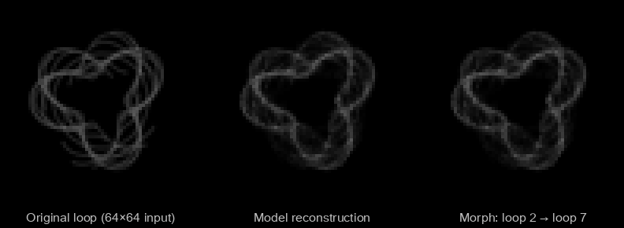
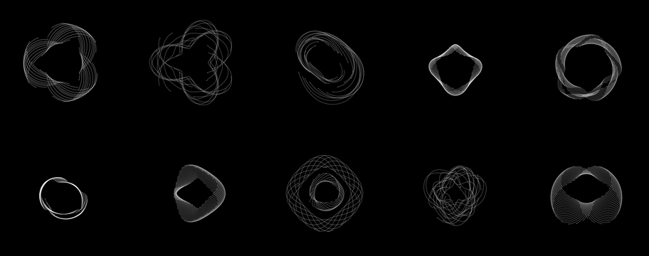
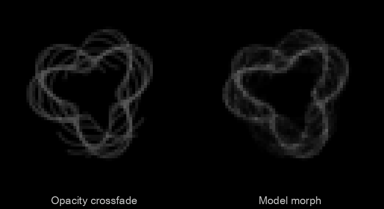
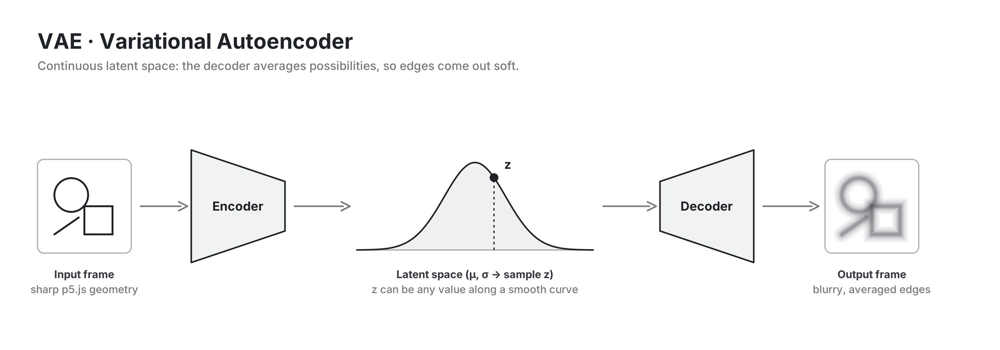
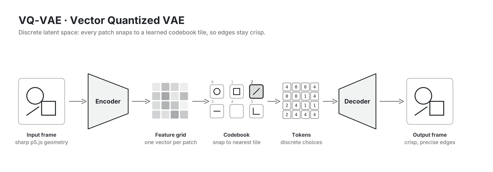
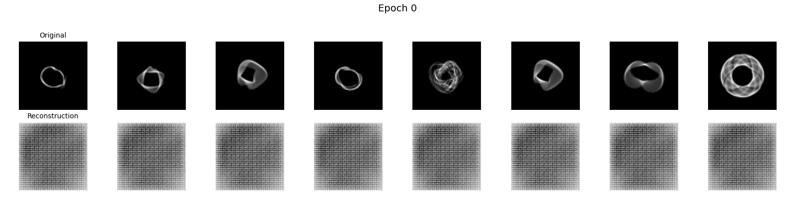
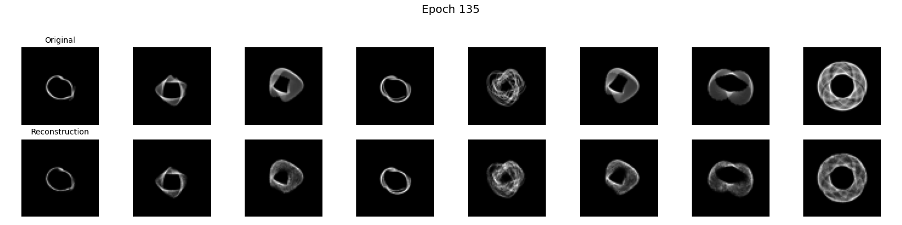
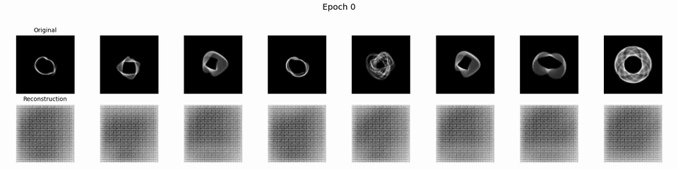
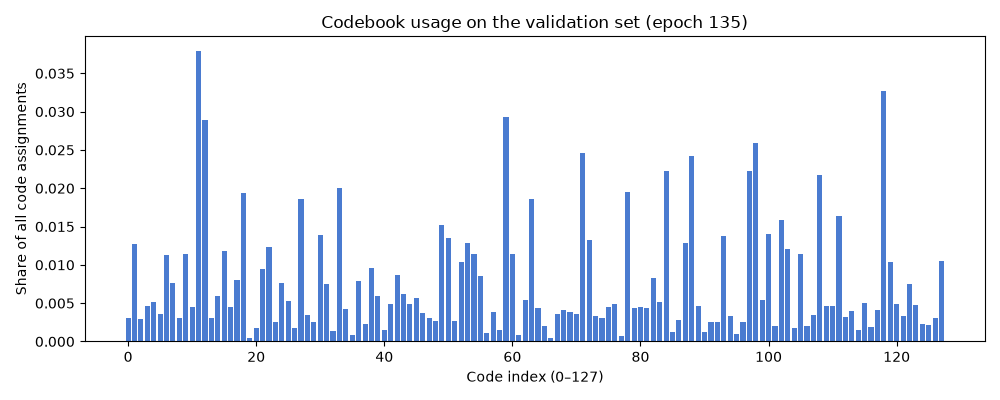

# Latent Loops
### A VQ-VAE I built in PyTorch to learn my p5.js animations and morph between them

<p align="center">
  
</p>

<sub>Left: loop 2 at the model's 64×64 input size. Middle: the trained model redrawing it from its code grid. Right: the model morphing loop 2 into loop 7 and back. Best checkpoint (epoch 121), upscaled 6× with nearest-neighbour, slight contrast lift.</sub>

I make generative motion in p5.js. For this project I wrote a neural network that learns my visual language, and I trained it from zero on 1,800 frames from ten of my loops, on a MacBook. It describes every frame as an 8×8 grid of choices from a vocabulary of 128 visual words it invents itself, then redraws the frame from that description. Blend two descriptions and you get a morph instead of a crossfade: the in-between frames rebuild themselves through shapes I never drew.

The hard part was getting the model to use its vocabulary at all. Early versions collapsed onto a single code and could only paint black. Fixing that is the core of the engineering story below.

**Look at first:** [the morph](#-morphing-between-animations) → [before / after training](#-the-hard-part-getting-the-model-to-use-its-vocabulary) → [what I built vs what I used](#-what-i-built-vs-what-i-used)

**Role:** solo, from concept to the ten animations, data pipeline, model, training, morph tool and diagrams<br>
**Stack:** p5.js · Python · PyTorch · scikit-learn · trained locally on Apple Silicon (MPS)<br>
**Scope:** learns and morphs between existing animations. It doesn't generate new ones yet ([why](#-limitations-and-next-steps)).

## 🎨 The idea

These are the ten loops the model learned: layered hairline strokes forming knots, rings and ribbons, white on black.

<p align="center">
  
</p>

<sub>All ten source loops (1024×1024 originals, shown downscaled). Each 180-frame loop plays in full, sped up.</sub>

The model never sees pixels the way a crossfade does. It sees each frame as 64 cells, and each cell is labelled with one **code** (a visual word) from a learned **codebook** (the vocabulary). To morph, I blend the model's internal descriptions of two frames and let it redraw every step. The difference from a plain opacity crossfade between the same two frames is easy to see:

<p align="center">
  
</p>

<sub>Same start and end frame (loop 2 frame 112 → loop 7 frame 91). Left: pixel crossfade, a double exposure. Right: model morph, where the shape itself changes.</sub>

## 🧠 Why a VQ-VAE (and not a plain VAE)

Both are **autoencoders**: networks that compress an image into a short description and then redraw the image from that description alone.

1. **VAE (variational autoencoder).** A VAE describes each frame with continuous numbers. That makes blending easy, but with standard settings VAEs tend to average between plausible outputs, and on images that average looks like soft, smeared edges. My loops are built from thin overlapping strokes, so I went with the variant that has to commit. *(This rationale comes from the literature. I didn't train a VAE baseline here.)*

   <picture>
     <source media="(prefers-color-scheme: dark)" srcset="Images/vae-dark.png">
     
   </picture>

2. **VQ-VAE (vector-quantised VAE).** A VQ-VAE adds one constraint: every cell of the 8×8 description grid must snap to its nearest entry in a **codebook** of 128 learned vectors. Think of them as visual words, not pixel stamps. Each code is 64 numbers the decoder has learned to paint, and neighbouring cells blend into each other. Committing to codes instead of averaging tends to keep edges crisper. It also makes the model's internal state something you can see and count, which mattered a lot when training went wrong.

   <picture>
     <source media="(prefers-color-scheme: dark)" srcset="Images/vqvae-dark.png">
     
   </picture>

The model works at 64×64 grayscale so it can train on a laptop. That size already softens my 1024 px hairlines into thin grey bands, which is why reconstructions look softer than the originals even when the shapes are right.

## 🔧 The hard part: getting the model to use its vocabulary

The biggest problem was **codebook collapse**: the model stopped using its vocabulary. In early runs every cell of every frame mapped to the same single code, so the decoder could only paint black. Perplexity, a measure of how many codes are effectively in use, sat at ≈ 1 of 128. These early runs happened before the fixes below; their logs aren't committed.

<!-- TODO(Niklaz): confirm the root cause of the early collapse from your notes on those runs. One candidate visible in the code: the codebook starts uniform in ±1/128 (models/vqvae_model.py), far from the encoder's output scale, so one code is nearest to everything. Replace the sentence below once confirmed. -->
*Root cause: to be confirmed from the notes on those early runs.*

Four fixes, all standard in the VQ-VAE literature, got the model using its vocabulary:

- **Smoothed codebook updates (EMA).** Each code drifts slowly toward the average of the encoder outputs it's chosen for, instead of being pushed by gradients.
- **Codebook seeded from real data (K-Means).** The vocabulary starts as cluster centres of actual encoder outputs, so every code begins near something it can describe.
- **Eased-in commitment (β warm-up).** The pull of the encoder toward its chosen codes starts gentle and tightens over the first 30 epochs.
- **Recycled dead codes.** Codes that fall out of use are reset next to a real encoder output or a popular code, so they can compete again.

| | Collapsed VQ-VAE (early runs) | With the four fixes (documented runs) |
|---|---|---|
| Reconstructions | Black | Close reconstructions of the source shapes |
| Codebook perplexity | ≈ 1 of 128 | 85–87 (refactored run) and 92 (original run) |
| Training behaviour | Collapses early | Recovers dead codes; converges |

The same fixed validation batch before and after training. An **epoch** is one full pass over all training frames.

**Epoch 0:** before any learning, the decoder outputs the same grey, checkerboard-like grid for every frame. This is a typical artefact of untrained transposed convolutions.



**Epoch 135:** the outlines and shapes of all eight validation frames come back closely. Filled regions show some grain compared with the originals.



The whole progression as motion, from the original 200-epoch run (the pre-refactor baseline):

<p align="center">
  
</p>

<sub>Original 200-epoch run, every second epoch from 0 to 198. Top: original frames. Bottom: reconstructions.</sub>



<sub>Codebook usage on the validation set at epoch 135 (refactored run). **How to read it:** one bar per code. A broad, uneven field of bars means the vocabulary is in use, while collapse would be one tall spike and 127 empty slots. All 128 codes appear here; the busiest is used about 87× as often as the rarest.</sub>

## 🌀 Morphing between animations

Reconstruction quality shows that the model can compress and restore frames. It says little about how its internal space is organised. To look at that, I built a **latent walk** tool that morphs between any two frames.

The trick is *where* the blend happens. Code numbers are just labels: averaging code #12 and code #87 is as meaningless as averaging the page numbers of two words in a dictionary. So I blend the encoder's continuous, pre-snap descriptions of the two frames (z_e) and let the quantiser snap each blended cell to its nearest code. As the blend moves, individual cells switch codes at different moments, sometimes through codes that belong to neither frame. That's why the shape rebuilds itself instead of crossfading.

In the hero morph above, the three-lobed outline of loop 2 contracts toward a ring before opening into the rounded square of loop 7. The model decodes every in-between frame, and none of them is in the training data. These are blends between two real frames, not freely generated animation (see [Limitations](#-limitations-and-next-steps)).

The repo also includes an earlier [latent walk demo](Images/morph_anim1_to_anim5.mp4) from loop 1 to loop 5: 120 frames at 64×64, 30 fps.
<!-- TODO(Niklaz): describe what morph_anim1_to_anim5.mp4 actually shows (the audit read it as a faint three-lobed outline opening into a ring), and which run/checkpoint produced it. Neither best checkpoint in outputs/ (refactored epoch 121, original epoch 191) reproduces it exactly when re-rendered through the same libx264 export (pixel correlation ≈ 0.64), so it likely comes from an earlier checkpoint. -->
*Description and source checkpoint of this clip: to be confirmed.*

What the walks suggest, qualitatively and not as proof of semantic understanding or of generalisation beyond this dataset:

- **Structured space:** in the walks I ran, nearby points decode to visually similar images.
- **Usable vocabulary:** the walks didn't hit large dead regions that decode to blank frames, which is consistent with the codebook chart above.
- **Encoder and decoder fit together:** the decoder produces coherent images for blended descriptions, not only for encodings of training frames.

## 📊 Results at a glance

| | |
|---|---|
| **Dataset** | 1,800 frames: 10 original p5.js loops × 180 frames. Source PNGs are 1024×1024 RGBA, resized to **64×64 grayscale**. 90/10 train/validation split (1,620 / 180 frames), seed 42 |
| **Model** | 485,121 parameters: 476,929 in the encoder and decoder (trained with Adam) + 8,192 in the codebook (128 codes × 64 numbers, updated by EMA). Each frame becomes an 8×8 grid of codes |
| **Documented run** (refactored code) | Early stopping triggered at epoch 136 (137 epochs). **Best checkpoint: epoch 121, validation loss 0.0490, validation perplexity ≈ 87.** At the stop, epoch 136: 0.0492 and ≈ 85 |
| **Training environment** | MacBook Pro, Apple Silicon (MPS), roughly 20 s per epoch (≈ 45 min for this run, estimated) |
| **Visual evidence** | Reconstructions at epoch 0 and 135, codebook usage at epoch 135, training progression, morphs: all in [`Images/`](Images/) |

<sub>All metrics are **reported from the documented Apple Silicon training runs** and weren't re-measured for this README. The training logs aren't committed (`outputs/` is git-ignored), so the numbers can't be re-derived from this repository without retraining. The morph and hero GIFs use the best checkpoint (epoch 121); the epoch-135 images show the last saved visualisation before the stop.</sub>

## 🧰 What I built vs what I used

| I built | I used (libraries and tools) |
|---|---|
| The ten p5.js animations and the 1,800-frame dataset | **PyTorch:** conv layers, Adam optimiser, autograd, MPS backend |
| Data pipeline: loading, resizing and grayscale conversion of the frames | **torchvision / Pillow:** image loading and transforms |
| Vector quantiser: nearest-code search, EMA codebook updates, straight-through gradient, dead-code recovery, perplexity tracking | **scikit-learn:** the K-Means algorithm used to seed the codebook |
| Training loop: β warm-up, LR scheduling, early stopping, checkpoints, visualisations | **matplotlib, pandas:** plots and log reading |
| Latent walk tool (z_e interpolation → MP4) | **imageio + ffmpeg:** video export |
| The refactor check: retraining and comparing against the original run | **pytest** |
| Diagrams and visual documentation | |

"From scratch" here means: no pretrained weights and no VQ library. The model is assembled from standard PyTorch layers.

**Tools & AI assistance:** Gemini 2.5 Flash was my sparring partner throughout the project, for research and for testing ideas. Claude Code came in only afterwards, to tidy the project: checking that the code is well structured, refactoring the backend and keeping the documentation in order. The model, its training and the animations are my own work.

Code comments, docstrings and console logs are in Swedish, my working language, by choice. The documentation is in English.

## 🚧 Limitations and next steps

- **Reconstruction and interpolation, not generation of new animations.** No temporal prior (e.g. a Transformer over code sequences) is trained, so the model can't invent coherent new animations over time. It reconstructs frames and creates interpolation-based morphs between frames. `generate.py` decodes *random* code grids, which yields single images without temporal coherence.
- **Frame model, not a video model.** Every frame is encoded independently as a 64×64 grayscale image. Motion is only implicit in the frame order.
- **Small, curated dataset.** 1,800 frames from 10 animations by one author, with a random frame-level train/validation split. Validation frames therefore come from the same loops as training frames, so the validation loss measures reconstruction of held-out frames of *known* animations, not generalisation to new ones.
- **No pretrained weights** are included. Reproducing the results requires training locally.
- **Reproducibility is approximate.** Seeds are fixed, but MPS/GPU kernels aren't bit-for-bit deterministic. Results may vary across runs, hardware and PyTorch versions.
- **Training logs from the documented runs aren't committed.** The reported metrics can't be re-derived from this repository without retraining.
- **Known rough edges:** the training and validation loops catch any exception per batch and `continue` (`train_vqvae.py`), which could hide real errors. `codebook_loss_weight` is accepted but ignored, because the codebook is updated by EMA and the loss is always reconstruction + β × commitment. `plot_training_curve()` in `utils.py` calls `sys.exit(1)`, with a "training aborted" message, if the last five validation losses vary by more than 0.02 standard deviation.

**Possible next steps:** train a prior over code grids (e.g. a small Transformer) so the model can compose new loops rather than only blend existing ones; train at a higher resolution to keep more of the hairline detail.

## 💡 What I learned

The project went through three phases. First, data: turning ten p5.js loops into a clean 1,800-frame grayscale dataset. Second, the model: hitting codebook collapse (black outputs, perplexity ≈ 1) and fixing it with EMA updates, K-Means seeding, β warm-up and dead-code recovery. Third, exploration: building the latent walk to see what the model had actually learned.

- **Watch the vocabulary, not just the loss.** Perplexity tells you directly whether the model is using its codes; ≈ 1 means collapse.
- **Where you blend decides what you get.** Blending pre-snap descriptions (z_e) gives new forms; blending code labels is meaningless.
- **Constraints shape the design.** Training on a laptop set the image size, the codebook size and the epoch budget. I'd rather state what those choices cost visually than hide it.
- **Research code can be clean code.** After a refactor (typed config, safer checkpoint loading, tests), the retrained model matched the original within single-run noise.

<details>
<summary><b>🔬 Technical deep dive</b>: architecture, losses, anti-collapse mechanics, validation, references</summary>

#### Architecture

| Stage | Layers | Output shape |
|---|---|---|
| Input | 64×64 grayscale frame | `[B, 1, 64, 64]` |
| Encoder | Conv 1→32 (k4 s2) → ReLU → Conv 32→64 (k4 s2) → ReLU → Conv 64→128 (k4 s2) → ReLU → BatchNorm → Conv 128→64 (k3 s1) | `z_e [B, 64, 8, 8]` |
| Vector quantiser | Nearest of 128 codes (64-d) per cell, EMA updates, dead-code recovery, straight-through estimator | `z_q [B, 64, 8, 8]` + indices `[B, 8, 8]` |
| Decoder | ConvT 64→128 (k3 s1) → ReLU → ConvT 128→64 (k4 s2) → ReLU → ConvT 64→32 (k4 s2) → ReLU → ConvT 32→1 (k4 s2) → Sigmoid | `[B, 1, 64, 64]` in [0, 1] |

#### Losses and metrics

- **Loss** = binary cross-entropy reconstruction loss + β × commitment loss, where the commitment loss is the MSE between the encoder output z_e and its (gradient-stopped) chosen code z_q. The codebook itself gets no gradient: it's updated by EMA, so there is no codebook loss term.
- **Validation loss** is that same total, averaged over validation batches. Because β ramps up during the first 30 epochs, early validation losses aren't directly comparable with later ones.
- **Perplexity** is exp(entropy) of code assignments, computed per validation batch and then averaged. It's an *effective* number of codes in use, not a count of distinct active codes. A perplexity of ≈ 85 means assignments are about as spread out as uniform use of 85 codes. (Computed over the whole validation set at once, epoch 135 gives ≈ 88.5; the per-batch average is lower because each batch sees fewer distinct codes.)

#### Anti-collapse mechanics

- **EMA codebook updates:** decay 0.99, ε = 1e-5 (Laplace-smoothed cluster sizes). The optimiser only updates the encoder and decoder.
- **K-Means initialisation:** before training, the (still untrained) encoder encodes up to 25 batches of 64 training frames, giving about 100k 64-d vectors subsampled to 50k. K-Means (k = 128, 10 restarts) then sets the initial codes.
- **β warm-up:** β rises linearly from 0.05 to 0.25 over epochs 0–30, then stays at 0.25. Keeping the commitment pressure low early on gives the encoder room to spread out before being pulled toward the codebook.
- **Dead-code recovery (`_recover_dead_codes`):** checked on a random ~10% of training forward passes. A code counts as dead when its EMA usage falls below 1e-6. With decay 0.99, a code starting from usage 1.0 has to go unused for roughly 1,400 batches (≈ 27 epochs at 51 batches per epoch), so the reset is deliberately conservative. Each dead code is re-initialised, 50/50, either from a random encoder output in the current batch or from one of the most-used codes, plus Gaussian noise (σ = 0.02) in both cases. Its EMA statistics are reset to 10% of the mean active usage.
- **Optimisation:** Adam, learning rate 2e-4, ReduceLROnPlateau (factor 0.5, patience 6, min 1e-6). Early stopping with patience 15 and min Δ 1e-4 on validation loss.

#### Why 128 codes

It's a balance. With too few codes, shapes from different animations would have to share codes and blur together. With too many, each code gets trained so rarely that many die off, which is the collapse problem again. 128 is the size I trained and documented. At epoch 135 every one of the 128 codes was in use on the validation set (perplexity ≈ 85), so the vocabulary was neither starved nor wasted.
<!-- TODO(Niklaz): did you actually train 32 or 512+ codebooks? If yes, add one line with what happened (that turns this paragraph from reasoning into evidence). If not, leave the paragraph as reasoning. -->

#### Latent walk method

`latent_walk.py` encodes two frames to z_e (`[1, 64, 8, 8]`), linearly interpolates `(1 − α)·z_e_A + α·z_e_B` over N steps, quantises each blend to its nearest codes and decodes it. Interpolating code *indices* isn't meaningful, because indices are categorical labels with no order. Interpolating the quantised vectors z_q would also be possible; blending z_e and re-quantising lets each cell switch codes at its own moment.

#### Refactor check

After a refactor (type hints, dataclass config, `weights_only=True` checkpoint loading, and a test suite), I retrained and compared the result against the original implementation. Both rows are **reported from the documented Apple Silicon training runs**, and each is a single run:

| Version | Best val loss | Epochs | Val perplexity | Notes |
|---------|----------|--------|------------|-------|
| **Refactored** | 0.0490 (epoch 121) | 137 (early stop at epoch 136) | ≈ 87 at best, ≈ 85 at stop | Type hints, tests, safer checkpoint loading |
| **Original** | 0.0486 (epoch 191) | 200 | ≈ 92 | Pre-refactor baseline |

**Result:** the refactored code reached a comparable best validation loss (0.8% higher) and stopped early after 137 epochs instead of running all 200. One run per version isn't enough to tell whether the small differences in loss and perplexity are meaningful. The comparison shows no evidence of a regression, but it doesn't prove equivalence.

The test suite (`tests/test_basic.py`) consists of 5 fast tests on random inputs. They check tensor shapes through the encoder, decoder and full model, the encode→decode index roundtrip, and that reconstructions stay in [0, 1]. They don't test training dynamics, EMA updates or dead-code recovery.

#### A note on scope and hardware

This project was deliberately sized for local training on a MacBook Pro via MPS (Metal Performance Shaders). The dataset (1,800 frames), model size (128 codes, 64-d), and training budget (up to 200 epochs) were all chosen to fit within that constraint. The techniques used (EMA updates, K-Means seeding, β warm-up, dead-code recovery, continuous-space interpolation) are standard in larger VQ-VAE work too. How well these specific settings transfer to bigger datasets and codebooks hasn't been tested here.

#### Background

I came to this from studying machine learning and deep learning through MIT OpenCourseWare and IBM's AI programme. I wanted to move from theory to an implementation of my own, trained on my own work.
<!-- TODO(Niklaz): confirm the exact IBM programme name and platform (e.g. "IBM AI Engineering Professional Certificate" on Coursera, or a YouTube series) and update the sentence above. -->

#### References

- van den Oord, Vinyals, Kavukcuoglu (2017). *Neural Discrete Representation Learning* (VQ-VAE, including EMA codebook updates). [arXiv:1711.00937](https://arxiv.org/abs/1711.00937)
- Łańcucki et al. (2020). *Robust Training of Vector Quantized Bottleneck Models* (K-Means initialisation and codebook resets). [arXiv:2005.08520](https://arxiv.org/abs/2005.08520)
- Dhariwal et al. (2020). *Jukebox: A Generative Model for Music* (random restarts for unused codes). [arXiv:2005.00341](https://arxiv.org/abs/2005.00341)

</details>

## 🚀 Run it yourself

The dataset of p5.js animation frames is included in `data/`. No pretrained weights are included, so you train your own.

### 1. Install dependencies

Python 3.10+ is required.

```bash
python3 -m venv .venv && source .venv/bin/activate
pip install -r requirements.txt
```

### 2. Run the tests

```bash
python -m pytest
```

### 3. Train

Run all scripts **from the repository root**, since paths such as `data/` and `outputs/` are relative:

```bash
python start_training.py
```

`start_training.py` has no command-line arguments; all settings live in `config.py`. With the defaults, training runs for up to 200 epochs with early stopping (patience 15). On an Apple Silicon MacBook, an epoch takes on the order of 20 seconds.

### 4. Inspect results

* **Reconstructions:** `outputs/images/ema_recon_epoch_XXXX.png`, saved every 5 epochs.
* **Codebook usage:** `outputs/logs/codebook_usage_epoch_XXXX.png`, saved every 5 epochs.
* **Metrics:** `outputs/logs/training_log.csv`, one row per epoch.
* **Checkpoints:** `outputs/checkpoints/vqvae_best.pth` (lowest validation loss).
* **Training curve:** the training loop doesn't draw it automatically. Generate it with:
  ```bash
  python -c "from utils import plot_training_curve; plot_training_curve()"
  ```
  Note: this exits without plotting if the last five validation losses vary a lot (see Known rough edges).

### 5. Explore the latent space

Requires a trained checkpoint at `outputs/checkpoints/vqvae_best.pth`. Frames are numbered from `0001` to `0180` per animation; frame `0001` of most loops is nearly empty, so pick a frame from the middle of a loop for readable morphs.

```bash
python latent_walk.py \
  --frame_a data/frames_animation2/frames_animation2_frame_0112.png \
  --frame_b data/frames_animation7/frames_animation7_frame_0091.png \
  --steps 120 --fps 30 --output outputs/morph_anim2_to_anim7.mp4

python generate.py --num_samples 4   # random-code decoding, see Limitations
```

Add `--save_frames` to also write every step as a PNG. Those always go to `outputs/latent_walk_frames/`, whatever `--output` is set to.

Expect results *similar* to the documented run, not identical ones. See [Limitations](#-limitations-and-next-steps).

## 📂 Project structure

* `config.py`: all settings in one place: image size, codebook size, learning rate, β schedule, anti-collapse parameters.
* `models/vqvae_model.py`: encoder, vector quantiser (one code per cell of the 8×8 grid; EMA updates, K-Means init, dead-code recovery, perplexity) and decoder.
* `train_vqvae.py`: training loop with β warm-up, LR scheduling, early stopping and checkpoints.
* `start_training.py`: entry point. It loads the data, splits train/validation and starts training (no command-line arguments).
* `dataset_loader.py`: loads the exported p5.js PNG frames and converts them to 64×64 grayscale tensors.
* `utils.py`: checkpoint lookup, reconstruction previews, codebook-usage chart, training-curve plot.
* `latent_walk.py`: morph tool that blends two frames' encodings and writes an MP4.
* `generate.py`: decodes *random* code grids into single images (a proof of concept; see Limitations).
* `visualizations.py`: placeholder for future plots.
* `tests/test_basic.py`: shape and range tests.

## 📄 License

- **Source code** is released under the [MIT License](LICENSE).
- **Creative assets are not MIT-licensed.** The original p5.js animation frames in `data/`, the visual material in `Images/`, and any included example media are © Niklaz Hallberg, all rights reserved. They may not be reused, redistributed, or used for model training without written permission. See [ASSETS_LICENSE.md](ASSETS_LICENSE.md).

---

Built by **Niklaz Hallberg** – [niklaz.works](https://niklaz.works)
